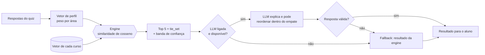
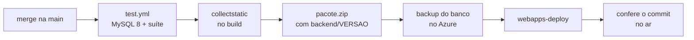

<div align="center">

# 🎓 EducMatch

**O aluno responde um quiz, e o EducMatch mostra quais cursos do SENAI combinam com ele e por quê.**

[](https://www.python.org/)
[](https://www.djangoproject.com/)
[](https://educmatch-7249.azurewebsites.net)
[](https://github.com/Santozs2/educmatch/actions/workflows/test.yml)
[](https://github.com/Santozs2/educmatch/actions/workflows/deploy.yml)

[🌐 Site no ar](https://educmatch-7249.azurewebsites.net) ·
[🧮 Como a engine funciona](docs/apresentacao/engine.md) ·
[🤖 Camada de IA](docs/apresentacao/ia.md) ·
[🗂️ Modelo de dados](docs/DER.png)

</div>

---

Projeto de TCC em produção no **SENAI São José do Rio Preto (CFP 8.01 Antonio Devisate)**.

O aluno responde 10 perguntas e recebe os **5 cursos mais parecidos com o perfil dele**. Os cursos vêm do catálogo real da escola, e cada um vem com uma explicação em linguagem natural. A coordenação acompanha a procura num painel e, no fim de cada curso, coleta a avaliação da turma pelo mesmo sistema.

## 📑 Sumário

- [Funcionalidades](#-funcionalidades)
- [Como funciona a recomendação](#-como-funciona-a-recomendação)
- [Arquitetura](#️-arquitetura)
- [Como rodar na sua máquina](#-como-rodar-na-sua-máquina)
- [Configuração](#️-configuração)
- [Rotas](#️-rotas)
- [Testes e comandos de apoio](#-testes-e-comandos-de-apoio)
- [Deploy e produção](#-deploy-e-produção)
- [Privacidade](#-privacidade)
- [Documentação](#-documentação)
- [Como contribuir](#-como-contribuir)

## ✨ Funcionalidades

**Para o aluno**
- Quiz de 10 perguntas, que pode ser respondido sem login ou por um link gerado pela coordenação
- Resultado com os 5 cursos mais parecidos com o perfil, as áreas que mais pesaram na escolha e um aviso quando há empate no topo
- Explicação escrita por IA, quando a IA está ligada
- Página de cada curso com os dados reais do SENAI (nível, duração, modalidade) e um link para a inscrição
- Conta com histórico de testes, perfil e uma lista de cursos de interesse

**Para a coordenação** (usuário *staff*)
- Painel com métricas do quiz, filtradas por período: cursos mais recomendados, demanda por área, conversão em interesse e distribuição de confiança
- Catálogo editável: busca, filtros e paginação nos cursos e nas áreas, edição do peso de cada curso por área
- **Consultor de IA** no cadastro de curso: a partir da descrição, sugere áreas, nome e texto, mostra cursos parecidos e avisa sobre possível duplicidade. Ele só sugere; quem salva é o administrador
- Gestão de áreas: criar, editar, desativar e reativar. Uma área só pode ser excluída se nenhum curso ou peso do quiz estiver ligado a ela
- Links de questionário para abrir e fechar por turma
- Lista de quem marcou interesse em cada curso
- Avaliação de fim de curso **anônima**, respondida por link público, com resultados exportáveis em `.csv`

## 🧠 Como funciona a recomendação

São duas camadas. A primeira sempre responde, e a segunda é opcional.



### 1. Engine (`quiz/engine.py`): determinística

Cada alternativa do quiz soma pesos a uma ou mais áreas, e as respostas viram um **vetor de perfil**. Esse vetor é comparado por **similaridade de cosseno** com o vetor de cada curso (`Peso_curso`). Para cada tentativa, a engine devolve:

- os **5 cursos** mais parecidos (`QUIZ_RECOMENDACAO_LIMIT`), cada um com o seu `rank_engine`;
- as **3 áreas** que mais pesaram em cada curso;
- a **banda de confiança**, calculada pela diferença entre o 1º e o 2º lugar;
- o **`tie_set`**: os cursos empatados no topo, com diferença de até `EMPATE = 0.02`.

### 2. Entrega (`quiz/delivery.py`): opcional

A entrega manda para uma LLM um payload **sem dados pessoais**: só o vetor de áreas e os cursos candidatos. A LLM escreve a explicação e pode reordenar a lista, mas **só pode pôr em 1º lugar um curso que já esteja no `tie_set`**. Quem decide é a engine; a IA só explica e desempata.

A resposta passa por validação de contrato (`quiz/serializers.py`). Se falhar, se estourar o timeout ou se o provedor cair, o aluno recebe o resultado da engine como está (`used_fallback=True`). Depois de uma falha, uma pausa de `LLM_PAUSA` segundos é gravada no cache, e os próximos alunos vão direto para a engine, sem esperar o timeout um por um.

Cada tentativa registra `llm_model`, `prompt_version`, `latency_ms`, `tokens_in`/`tokens_out`, `used_fallback`, `diverged` e `cache_hit`, para a análise do TCC. Com `LLM_ENABLED=0`, a camada de IA é desligada por completo.

## 🏛️ Arquitetura

Uma aplicação **Django única, renderizada no servidor** (MVT): templates, CSS e JavaScript estáticos, **sem build step** e sem SPA.

```
educmatch/
├─ backend/
│  ├─ core/        settings, rotas raiz, contexto global e testes de infraestrutura
│  ├─ quiz/        questões, tentativas, engine de cosseno, entrega com LLM (llm/, prompts/)
│  ├─ catalogo/    áreas, cursos e pesos; catálogo real em dados/cursos_senai_801.csv
│  ├─ accounts/    usuário customizado, login/cadastro, lista de interesse
│  ├─ avaliacao/   avaliação de fim de curso, respondida por link público
│  ├─ painel/      telas da coordenação: métricas, cursos, áreas, links, avaliações e consultor de IA
│  ├─ templates/   base.html, componentes/ e telas do quiz
│  ├─ static/      css/ (por tela, sobre tokens.css) e js/
│  ├─ scripts/     carga_turma.py (teste de carga)
│  └─ startup.sh   inicialização no Azure
├─ docs/
│  ├─ apresentacao/  material da banca (engine, IA, contratos, backend, front, MVT)
│  ├─ catalogo-senai/ planilha de pesos dos cursos para revisão da escola
│  ├─ experimento/   CSVs do experimento engine x LLM
│  ├─ specs/         plano e passo a passo de cada fase
│  └─ DER.png        modelo de dados
└─ .github/workflows/ test.yml (CI) e deploy.yml (CD)
```

### O catálogo em números

| Áreas | Cursos | Quiz | Testes |
|:-:|:-:|:-:|:-:|
| **10** áreas do SENAI | **50** cursos reais (47 ativos) | **10** perguntas, versão 2 | **330+** testes automatizados |

Os cursos são de três níveis: cursos livres, Aprendiz SENAI e graduação. Os dados vêm de `catalogo/dados/cursos_senai_801.csv`. Nada do histórico é apagado: curso, área e pergunta antigos ficam **inativos**, não somem.

### Tecnologias

| Camada | Escolha |
| --- | --- |
| Linguagem e framework | Python 3.12, Django 5.2 LTS |
| Banco | MySQL em desenvolvimento e na CI (`mysqlclient`); SQLite em produção |
| Front | Templates Django, CSS com tokens, JavaScript sem framework |
| Servidor | gunicorn (`gthread`) e whitenoise |
| IA | Qualquer API compatível com OpenAI, ou Gemini; provedor `fake` para testes |
| Infra | Azure App Service Linux (F1), GitHub Actions com login OIDC |

> O `djangorestframework` continua instalado (os serializers validam a resposta da LLM), mas nenhuma rota de API pública está exposta.

## 🚀 Como rodar na sua máquina

**Pré-requisitos:** Python 3.12+. Para usar MySQL, também precisa de um servidor MySQL com o banco `educmatch` criado.

```bash
git clone https://github.com/Santozs2/educmatch.git
cd educmatch/backend
python -m venv .venv
source .venv/Scripts/activate   # Linux/macOS: source .venv/bin/activate
pip install -r requirements.txt
cp .env.example .env
```

Escolha o banco no `backend/.env`:

- **MySQL** (igual à CI): ajuste `DB_USER` e `DB_PASSWORD`. Antes, carregue as [tabelas de fuso](#tabelas-de-fuso-do-mysql-uma-vez-por-máquina).
- **SQLite** (o mais rápido para começar): use `DB_ENGINE=sqlite` e apague a linha `DB_NAME`. O banco vai para `backend/db.sqlite3`.

Depois prepare o banco e suba o servidor:

```bash
python manage.py preparar_producao   # migrate, tabela de cache e todos os seeds
python manage.py createsuperuser     # usuário staff, para entrar no painel
python manage.py runserver           # http://localhost:8000
```

O `preparar_producao` faz o mesmo que o servidor faz no boot. Os seeds usam `update_or_create`, então dá para rodar de novo sem duplicar nada. Se preferir rodar passo a passo: `migrate`, `createcachetable`, `seed` (áreas, cursos e questões) e `seed_avaliacao`.

Para conferir: o painel deve mostrar **10 áreas** e **50 cursos**.

### Tabelas de fuso do MySQL (uma vez por máquina)

O projeto usa `TIME_ZONE = "America/Sao_Paulo"`, e o MySQL vem sem as tabelas de fuso. Sem elas, todo filtro por data do painel volta vazio, **sem nenhum erro**. Baixe o pacote POSIX em <https://dev.mysql.com/downloads/timezones.html> e rode:

```bash
mysql -u root -p mysql < timezone_posix.sql
```

Para saber se deu certo, rode `python manage.py test core`.

## ⚙️ Configuração

Tudo que muda de uma máquina para outra vem de variável de ambiente. O `core/settings.py` lê o `backend/.env` sozinho, e os nomes das variáveis estão em [`backend/.env.example`](backend/.env.example). O `.env` **nunca** vai para o Git.

Os valores booleanos aceitam `1/0` ou `true/false` (por exemplo, `DJANGO_DEBUG=true` e `LLM_ENABLED=0`).

| Grupo | Variáveis |
| --- | --- |
| Django | `DJANGO_SECRET_KEY`, `DJANGO_DEBUG`, `DJANGO_ALLOWED_HOSTS` |
| Banco | `DB_ENGINE` (`mysql` por padrão, ou `sqlite`), `DB_NAME`, `DB_USER`, `DB_PASSWORD`, `DB_HOST`, `DB_PORT`, `DB_SSL_CA` |
| Escola | `ESCOLA_NOME`, `ESCOLA_ENDERECO`, `ESCOLA_TELEFONE`: aparecem nas telas |
| LLM | `LLM_ENABLED`, `LLM_PROVIDER` (`fake`, `gemini` ou `openai_compat`), `LLM_BASE_URL`, `LLM_MODEL`, `LLM_API_KEY`, `LLM_TIMEOUT`, `LLM_TIMEOUT_CONSULTOR`, `LLM_PROMPT_VERSION`, `LLM_PAUSA` |
| Servidor | `GUNICORN_WORKERS`, `GUNICORN_THREADS` (só no `startup.sh`) |

> 💡 O provedor `fake` responde sem usar a rede. É ele que os testes usam, e serve para desenvolver a tela de resultado sem gastar cota da API.

## 🗺️ Rotas

### Aluno

| Rota | O que é |
| --- | --- |
| `/` | início do quiz |
| `/questionario/<token>/` | quiz aberto pelo link gerado no painel |
| `/resultado/<id>/` | resultado com os cursos recomendados |
| `/cursos/<id>/` | detalhe do curso |
| `/entrar/`, `/cadastro_usuario/`, `/logout/` | conta |
| `/meus-testes/`, `/meu-perfil/`, `/lista_interesse/` | área do aluno |
| `/avaliacao/<token>/` | avaliação de fim de curso (link público, sem login) |

### Coordenação (*staff*)

| Rota | O que é |
| --- | --- |
| `/painel/` | visão geral |
| `/painel/quiz/` | métricas do quiz |
| `/painel/cursos/` | catálogo: busca, filtros, edição de curso e consultor de IA |
| `/painel/areas/` | áreas: criar, editar, desativar, reativar e excluir |
| `/painel/links/` | gerar e fechar links de questionário |
| `/painel/interesse/` | quem marcou interesse em quais cursos |
| `/painel/avaliacoes/` | links de avaliação por curso e turma |
| `/painel/avaliacoes/resultados/` | resultados, com exportação em `.csv` |
| `/admin/` | admin do Django |

> O endereço antigo `/quiz/dashboard/` redireciona para `/painel/`.

## 🧪 Testes e comandos de apoio

```bash
cd backend
python manage.py test
```

A suíte cobre:
- a engine de recomendação e a camada de LLM (`quiz/tests/`);
- as rotas web e a lista de interesse (`accounts/tests/`);
- a avaliação de fim de curso (`avaliacao/tests/`);
- as métricas e as telas do painel (`painel/tests/`);
- o catálogo (`catalogo/tests.py`) e o fuso do banco (`core/tests.py`).

A CI roda os testes em todo PR e em todo push na `develop`, contra um MySQL 8 de verdade. Ela também falha se algum model mudar e ninguém criar a migration (`makemigrations --check`).

| Comando | Para quê |
| --- | --- |
| `python manage.py testar_llm` | testa o provedor configurado no `.env` |
| `python manage.py medir_empate` | calibra o limiar de empate da engine |
| `python manage.py experimento_ia` | roda N perfis na engine e na LLM e grava um CSV, sem deixar nada no banco |
| `python scripts/carga_turma.py` | simula uma turma inteira enviando o quiz ao mesmo tempo |

Os CSVs do experimento já gerados estão em [`docs/experimento/`](docs/experimento/).

## ☁️ Deploy e produção

O site roda no **Azure App Service Linux**, plano gratuito F1 (`rg-educmatch` / `educmatch-7249`), em <https://educmatch-7249.azurewebsites.net>.

### Pipeline



- **Automático:** o [`deploy.yml`](.github/workflows/deploy.yml) publica a cada merge na `main`, e só se os testes passarem. O login no Azure usa OIDC, sem senha guardada no GitHub.
- **Backup antes de publicar:** antes de cada deploy, o banco é copiado para `/home/data/backups/`, e ficam guardadas as 5 cópias mais recentes.
- **Versão no ar:** o pacote leva o commit no arquivo `backend/VERSAO`, que aparece no `<meta name="versao">` de toda página. O deploy só termina quando o site está servindo esse commit.
- **Rollback:** em Actions → *deploy* → *Run workflow*, informe a tag ou o commit no campo `versao`.

### O que acontece no boot (`startup.sh`)

1. `preparar_producao` roda `migrate`, `createcachetable` e os seeds **só quando a versão no ar mudou**. O marcador fica em `/home/data/.versao-preparada`, então quando o site só "acorda" depois de dormir, essa etapa é pulada.
2. `collectstatic`, só se o pacote veio sem os estáticos (deploy manual por zip).
3. O gunicorn sobe com worker `gthread`: 2 workers × 8 threads = **16 quizzes ao mesmo tempo**. A chamada à LLM é espera de rede, e com threads um worker atende outros alunos enquanto espera.

### Banco em produção

Em produção o banco é **SQLite** em `/home/data/educmatch.sqlite3` (`DB_ENGINE=sqlite`), porque o MySQL gerenciado do Azure não tem camada gratuita permanente. As transações usam `IMMEDIATE` com `timeout` de 20 s. Num teste com 30 alunos ao mesmo tempo, nenhuma gravação foi perdida (`scripts/carga_turma.py`).

<details>
<summary><b>Zerar o banco de produção</b></summary>

Pelo console do Kudu (`https://educmatch-7249.scm.azurewebsites.net`):

```bash
mv /home/data/educmatch.sqlite3 /home/data/backups/antes-de-zerar-$(date -u +%Y%m%d-%H%M).sqlite3.bak
rm /home/data/.versao-preparada
```

Depois reinicie o App Service. No boot, o `startup.sh` recria as tabelas e roda os seeds. **Usuários não são recriados**: abra o SSH do App Service e rode `python manage.py createsuperuser`.

⚠️ **Apague também o marcador.** Se só o banco sumir, o boot acha que a versão já foi preparada e o site sobe sem tabelas. Use `mv` em vez de `rm` no banco, para dar para voltar atrás. O final `.bak` evita que a limpeza automática de backups apague a cópia.

</details>

<details>
<summary><b>Publicar a <code>main</code> na mão</b></summary>

```bash
az webapp deployment source sync -g rg-educmatch -n educmatch-7249
```

Na raiz do repositório, o `requirements.txt` só inclui o de `backend/`, porque é na raiz que o Oryx procura as dependências. O comando de inicialização do App Service é `bash backend/startup.sh`.

</details>

## 🔒 Privacidade

- **A LLM nunca recebe dados pessoais:** nem nome, nem e-mail, nem id de usuário. Só o vetor de áreas e os cursos candidatos.
- **A avaliação de fim de curso é anônima por desenho:** o link é público e a resposta não fica ligada a nenhum usuário.
- **O painel mostra cursos, nunca pessoas.** Ele tem uma supressão k-anônima em `painel/privacidade.py`, que esconde o número de qualquer célula com menos de `k` ocorrências. A linha continua na tabela, para que a omissão não revele o valor. Por decisão do grupo em 01/10/2026, a supressão está **desligada** (`K_MINIMO = 0`). Para religar, volte a constante para `5`.

## 📚 Documentação

| Onde | O que tem |
| --- | --- |
| [`docs/apresentacao/`](docs/apresentacao/README.md) | Roteiro da banca: [engine](docs/apresentacao/engine.md) (com conta à mão e métricas de 5.000 perfis), [IA](docs/apresentacao/ia.md), [contratos](docs/apresentacao/contratos.md), [backend](docs/apresentacao/backend.md), [front](docs/apresentacao/frontend.md), [MVT](docs/apresentacao/mvt.md) e [demo](docs/apresentacao/demo-e-perguntas.md) |
| [`docs/specs/`](docs/specs/) | Plano e passo a passo de cada fase, incluindo o [catálogo real do SENAI](docs/specs/mudancas-catalogo-real-senai.md) |
| [`docs/experimento/`](docs/experimento/) | Resultados do experimento engine × LLM |
| [`docs/catalogo-senai/`](docs/catalogo-senai/) | Planilha de pesos dos cursos para a escola revisar |
| [`docs/DER.png`](docs/DER.png) | Modelo de dados |

> As notas de `docs/` foram escritas no Obsidian: os links `[[...]]` e os blocos `> [!info]` aparecem formatados lá.

## 🤝 Como contribuir

O fluxo é **feature → `develop` → `main`**. As branches `main` e `develop` são protegidas (`.github/rulesets/`).

1. Crie uma branch a partir da `develop`: `feat/...`, `fix/...`, `docs/...` (uma fase do plano = um PR).
2. Antes do PR, rode `python manage.py test` dentro de `backend/`.
3. Escreva as mensagens de commit no padrão [Conventional Commits](https://www.conventionalcommits.org/pt-br/), por exemplo `feat(painel): ...` ou `fix(quiz): ...`.
4. Abra o PR para a `develop`. A CI precisa passar.
5. O merge da `develop` na `main` publica em produção automaticamente.

---

<div align="center">
<sub>Feito como Trabalho de Conclusão de Curso no SENAI São José do Rio Preto · CFP 8.01 Antonio Devisate</sub>
</div>
